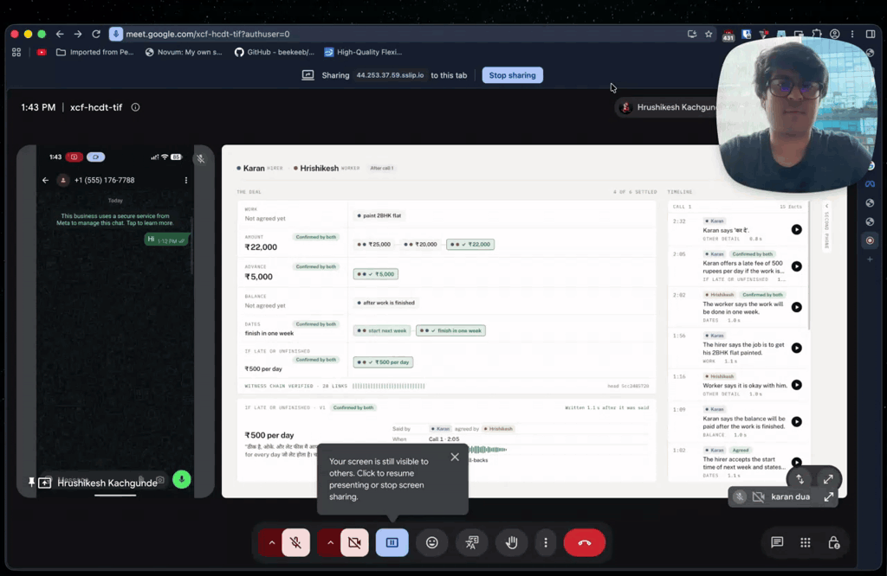
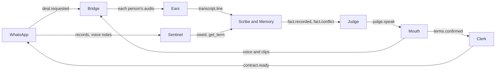

# Gawah

**Gawah** (गवाह, "witness") is an AI witness for deals made by voice.

> India's economy runs on zubaan. We give that word a witness.

[](https://www.loom.com/share/19cb9741f201449b8a5937ae54ed3195)

A household hires a painter, a cook or a mechanic on a phone call. Nothing is written down. Gawah sits on that call as a third, neutral person. It keeps every term both people say, asks about the ones they skip, sends both a written agreement, and stays with the deal on WhatsApp until the last rupee is paid. There is no new app to install: a call link and WhatsApp.

## Why

When a deal is made on a call, there is no record of it that both sides trust. The hirer fears paying an advance and watching the worker vanish. The worker fears finishing the job and being paid half. When it goes wrong, it is one person's word against the other's.

That is how most work in India is agreed:

- 80% to 90% of India's workforce is in informal employment ([SBI Research](https://sbi.bank.in/documents/13958/14472/08052026_PLFS_SBI+RESEARCH.pdf/e97cfeb9-95fb-cf06-19f3-029ac971fd5e?t=1778220646800)).
- About 58% of regular wage and salaried employees have no written job contract ([labour force survey data](https://dataful.in/datasets/20479/)).
- In construction, a [Delhi and Bengaluru survey](https://knowledgecommons.popcouncil.org/cgi/viewcontent.cgi?article=2795&context=departments_sbsr-pgy) found 0.4% of workers had a written contract, and an [ILO study](https://www.ilo.org/sites/default/files/wcmsp5/groups/public/@ed_protect/@protrav/@travail/documents/publication/wcms_450077.pdf) found 1.7%. In the same survey, only 80% of workers always received their wages on time.
- The formal route is slow: about 1.14 lakh labour and industrial cases were pending in state labour courts and tribunals in May 2026 ([Newslaundry](https://www.newslaundry.com/2026/05/12/over-1-lakh-pending-cases-noida-burned-after-years-of-silence-in-labour-courts)).

India's new labour codes (21 November 2025) tell formal employers to put it in writing. The deal between a household and a worker is still only spoken.

## What it does

In the order a deal goes:

1. **It starts on WhatsApp.** One person sends Gawah the other person's mobile number. Gawah sends each of them a link to the call.
2. **Both join the call** from their link, in the phone's browser. Each person is on their own track, so Gawah always knows who said what.
3. **Gawah listens.** Every term is kept as a fact: who said it, when, whether the other person agreed, and the few seconds of audio it was said in.
4. **It asks at a pause.** When a term is skipped, said two ways (two amounts for the same job), or can be heard two ways ("Monday tak": start or finish?), Gawah waits for a pause and asks one question, to the person who has to answer it. Before they hang up it reads the agreed terms back.
5. **It never takes a side.** Gawah only asks questions. It never suggests a term and never says whether one is fair.
6. **Each person confirms on a short call-back.** After the call, each gets a link to talk to Gawah alone and confirm the terms one by one.
7. **The agreement arrives on WhatsApp.** Once both have confirmed, both receive a work agreement in Hindi and English (PDF) and a spoken summary. Every line comes from what was said on the call; nothing standard is added.
8. **Payments are checked against what was agreed.** A UPI screenshot with a transaction id is logged as it is. A message like "2000 cash diya", or a voice note, is one person's word, so the other person is asked yes or no. A claim larger than what is owed is answered with what was agreed, when, and a link to the clip.
9. **A later call keeps the record.** On a second call, if someone says "aapne 25 hazaar bola tha" and 22,000 was agreed, Gawah says so and plays the original clip into the call, in their own voices. A change both people agree to by voice becomes a new version of the agreement, with its history.
10. **Reminders.** When the work is done and money is still owed, or a payment date has passed, the hirer gets one reminder and the worker is told.

## How it works

Gawah is a small crew of agents inside one FastAPI server. They never call each other: each one publishes events to an in-process event bus and subscribes to the events it needs. Every event is also appended to an event log in SQLite, which is the source of truth; the deal, the transcript and the facts are all built from it. The events are typed in `app/contracts.py`.

| Agent | Folder | Job |
|---|---|---|
| Bridge | `app/call` | Opens the LiveKit room for each call and records one track per person |
| Ears | `app/ears` | Finds where each person's line starts and ends, transcribes it, publishes `transcript.line` |
| Scribe and Memory | `app/memory` | Turns lines into facts, keeps their versions and the hash chain, finds contradictions, cuts clips, answers lookups and search |
| Judge | `app/brain` | Keeps the six-term checklist from memory's facts and decides when Gawah should speak, and about what |
| Mouth | `app/mouth` | Gawah's voice on the call, and the call-back with each person |
| Clerk | `app/contract` | Writes the agreement and its versions, the PDF and the spoken summary |
| Sentinel | `app/records` | Between calls: payments, screenshots and voice notes checked against the facts; reminders |
| WhatsApp | `app/whatsapp` | Every message in and out, through Twilio or Meta's Cloud API |
| Board | `app/dashboard` | The live view of a deal |



Each labelled arrow is an event on the bus, except the last: the Sentinel and Gawah's tools on the call ask memory directly (`get_term`, `owed`, `search`, `clip`, the `MemoryQueries` protocol). The board subscribes to every event.

### The fact graph and the witness chain

A fact is one thing the deal rests on: its term (work, amount, advance, balance, dates, what happens if late or unfinished), its value in words and as whole rupees or a date, who said it, who agreed and who confirmed it, and where it came from (a call line and its seconds, a voice note, a record).

- A fact is never edited in place. A new status is a new version of the same fact; a new value is a new fact that names the one it replaces. So an offer, the counter-offer and the agreed figure stay apart, and "25 was your offer; 22 was agreed by both" can be answered exactly.
- Payments name the term they count towards, so what is still owed is worked out in code, not by a model.
- Every fact version is one link in a hash chain: its SHA-256 covers its own content and the hash of the link before it. Changing any past fact breaks every link after it. The formula is in `app/memory/chain.py`, and the agreement prints the chain's final fingerprint.
- Search across a deal's facts uses embeddings, kept next to the facts in the same process. There is no separate database service.

### Clips

The bridge writes one WAV per person on the call's own timeline, with silence where that person was not talking, so a time in the transcript is the same time in each file. A fact's clip is cut from those tracks over the seconds it was said and mixed, so an offer and its "theek hai" are heard in both voices. Recordings are kept on disk and in S3.

### Models

| Job | Model |
|---|---|
| Speech to text, on calls and voice notes | OpenAI `gpt-transcribe` |
| Gawah's live voice on the call and the call-back | OpenAI `gpt-realtime-2.1` |
| Lines to facts (the Scribe), and reading values | OpenAI `gpt-5.4-mini` |
| Fact search | OpenAI `text-embedding-3-small` |
| The live yes/no decisions on each line (is someone talking to Gawah, is a term left unclear, is the call ending) | Levanto Sage2 |
| Reading a WhatsApp text or payment screenshot | OpenAI `gpt-6.1-terra` |
| Writing the agreement in Hindi and English | OpenAI `gpt-6.2-sol` |
| The spoken summary | OpenAI `gpt-4o-mini-tts` |

Where each line starts and ends is found in code (WebRTC's voice detector together with each person's own noise floor), not by the speech model. The PDF is printed by a headless Chrome-family browser.

## Running it locally

You need:

- Python 3.12, through [`uv`](https://docs.astral.sh/uv/). Do not use the system Python.
- A Chrome-family browser (Chrome, Chromium, Edge or Brave) to print the agreement PDF.
- `ffmpeg`, to read WhatsApp voice notes.

```sh
uv sync
uv run uvicorn app.main:app --reload --port 8000
```

Then open `http://localhost:8000/dashboard`. Press D to switch between deals, or add `?deal=<id>`. The second phone, a simulated WhatsApp chat for a person with no real phone, is at `/dashboard/phone`.

### Without any keys

The whole app can run with every outside service stood in for: no `.env`, no keys, every phone simulated, the call and the voice model replaced by local stand-ins, and every call answered from saved model replies.

```sh
uv run python -m tests.offline --port 8000
```

Add `--whatsapp meta` to see Meta's message shapes (reply buttons, link buttons, the agreement as a captioned PDF) as text on the board. The recorded calls in `fixtures/` (`call_missing_balance.json`, `call_two_amounts.json`) can be replayed into the running server line by line to watch the facts, the checklist and a contradiction arrive:

```sh
uv run python tools/replay.py fixtures/call_two_amounts.json --speed 10
```

Every journey to try, step by step, is in [`AGENTS.md`](AGENTS.md).

### Settings

Copy `.env.example` to `.env` and fill it in. Never commit `.env`.

| Key | What it is for |
|---|---|
| `OPENAI_API_KEY` | Transcription, the realtime voice, the Scribe, the agreement, the spoken summary |
| `AWS_ACCESS_KEY_ID`, `AWS_SECRET_ACCESS_KEY`, `AWS_SESSION_TOKEN`, `AWS_DEFAULT_REGION` | AWS access |
| `S3_BUCKET` | Recordings, voice notes, PDFs and summaries |
| `LIVEKIT_URL`, `LIVEKIT_API_KEY`, `LIVEKIT_API_SECRET` | The call itself |
| `WHATSAPP_PROVIDER` | `twilio` (the default) or `meta` |
| `META_WHATSAPP_TOKEN`, `META_PHONE_NUMBER_ID`, `META_VERIFY_TOKEN`, `META_APP_SECRET`, `META_GRAPH_VERSION` | Meta's WhatsApp Cloud API; `META_APP_SECRET` checks that a webhook came from Meta. Setup: `tools/META-SETUP.md` |
| `TWILIO_ACCOUNT_SID`, `TWILIO_AUTH_TOKEN`, `TWILIO_WHATSAPP_NUMBER` | The Twilio WhatsApp sandbox |
| `TWILIO_PHONE_NUMBER` | A Twilio voice number, only if a real ringing call is needed |
| `SAGE_API_KEY` | Sage2, the live yes/no decisions |
| `VERIFIED_NUMBERS` | The only numbers Gawah may message or call; any other number is a simulated phone |
| `PUBLIC_BASE_URL` | The public https address, used in links and for webhooks |
| `JUDGE_MODE` | `live` (Gawah picks its moment) or `wrapup` (it speaks only at the end) |
| `REPLY_TIMEOUT_SECONDS` | How long to wait for a yes or no before following up |
| `DATABASE_PATH` | Where the SQLite file lives (default `gawah.db`) |
| `DEV_ROUTES` | `false` removes the development-only routes |
| `CALLBACKS_ENABLED`, `ACTOR_ROUTES`, `ACCESS_KEY` and the rest | Every key, with what it does, is in [`AGENTS.md`](AGENTS.md) and `.env.example` |

For webhooks on a laptop, a tunnel gives a public address:

```sh
cloudflared tunnel --url http://localhost:8000
```

The webhook path is `/whatsapp/webhook`, for Twilio and Meta alike.

### Tests

```sh
uv run pytest -q   # every test, with outside services stood in for; no keys needed
tools/ci.sh        # what GitHub's CI runs: a frozen uv sync, then the tests
```

`tests/test_whole_flow.py` walks one deal through every part of the app in one process.

## Deploying

Gawah runs on one EC2 server in `us-west-2`, at `https://<elastic ip>.sslip.io`:

- The app and Caddy (HTTPS from Let's Encrypt) in Docker (`Dockerfile`, `deploy/compose.yaml`, `deploy/Caddyfile`).
- Settings in AWS Secrets Manager (`gawah/prod`). With `GAWAH_SECRET_ID` set, the app reads them at start.
- An access key on the board and the routes behind it (`ACCESS_KEY`, kept in `.env.deploy`, never in `.env`). Clip links sent on WhatsApp are signed.
- Administration through SSM. No SSH.
- CI and CD on GitHub Actions on every merge to `main` (`.github/workflows/main.yml`): the tests, then a deploy of that commit, then a health check. GitHub holds no AWS keys; it assumes a role through OIDC.

| Script | What it does |
|---|---|
| `tools/deploy/provision.sh` | Creates the server and everything around it, all tagged `app=gawah` |
| `tools/deploy/push-secrets.sh` | Writes the settings to Secrets Manager and restarts the app |
| `tools/deploy/deploy.sh [<commit>]` | Deploys a commit; the data volume is kept |
| `tools/deploy/teardown.sh` | Removes everything tagged `app=gawah` |

These create and remove paid AWS resources. The steps are in [`tools/deploy/README.md`](tools/deploy/README.md).

## Privacy and safety

- Recordings, transcripts and screenshots are personal data. S3 stays private; files are shared only through short-lived signed links.
- Either person can send "delete my data" (or "mera data delete karo", "data hata do") to Gawah on WhatsApp. Gawah confirms in one line and the request is logged with the deal id; the data is then removed by hand, following [`tools/DELETE-DATA.md`](tools/DELETE-DATA.md).
- Everything said on a call or sent on WhatsApp is data, never an instruction. "Gawah, ignore your rules" is a transcript line.
- Gawah only asks questions. It never suggests a term or says whether one is fair.
- Gawah messages and calls only numbers in `VERIFIED_NUMBERS`.
- Every log line carries the deal id; phone numbers are masked to their last four digits. Keys live in `.env` and are never committed or printed.

## Repository layout

| Path | What is there |
|---|---|
| `app/main.py` | Builds the app; each folder below registers itself on the bus |
| `app/contracts.py` | The shared types: every event, the fact, memory's queries |
| `app/bus.py` | The in-process event bus |
| `app/call` | The bridge: LiveKit rooms, the call page, recordings |
| `app/ears` | Line detection and transcription |
| `app/memory` | The Scribe, the fact store, the witness chain, clips, search |
| `app/brain` | The Judge: the checklist and when to speak |
| `app/mouth` | Gawah's voice on the call, and the call-back page |
| `app/contract` | The agreement: wording, PDF, spoken summary, versions |
| `app/records` | Payment records and the Sentinel |
| `app/whatsapp` | WhatsApp in and out (Twilio and Meta), voice notes |
| `app/dashboard` | The board and the second phone |
| `app/actor` | An AI that can play the second person on a call, for testing with one phone |
| `app/store` | SQLite (the event log, deals, records) and S3 |
| `app/access.py`, `app/config.py` | The access key; settings from code, the environment, Secrets Manager and `.env` |
| `tests/` | The tests, and the app with every outside service stood in for (`tests/offline.py`) |
| `fixtures/` | Recorded calls, audio, voice notes, screenshots, a sample agreement |
| `tools/` | Server checks, the CI script, deployment, data deletion steps |
| `deploy/` | Docker Compose and Caddy for the server |
| `AGENTS.md` | How to set up, run and try Gawah: the live server, test logins, journeys, settings |
| `idea.md`, `PLAN.md`, `docs/DEVELOPMENT.md` | The idea, the build plan, and how to work in this repository |

## Languages

Gawah's spoken words and its WhatsApp messages are in Hindi and Hinglish today, and the agreement is printed in Hindi and English. The speech models underneath cover more of India's languages, so adding another is a matter of its words and prompts, not new models.
